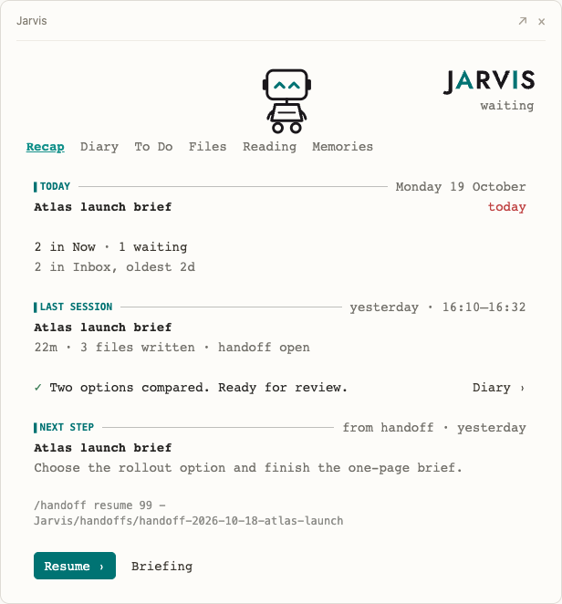
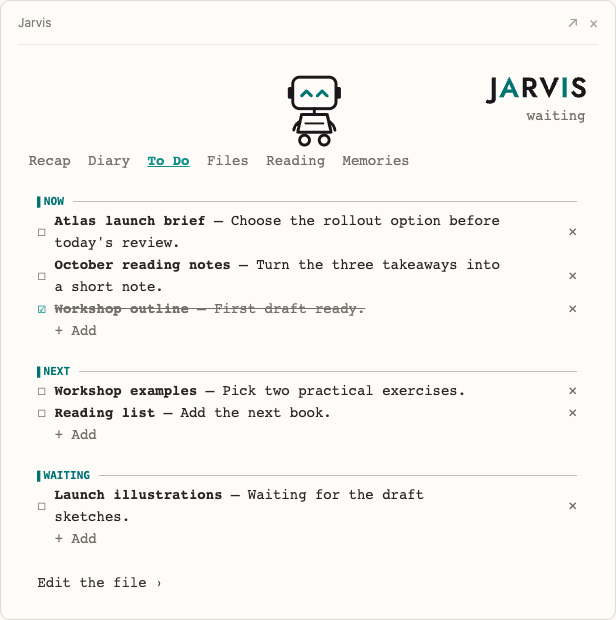
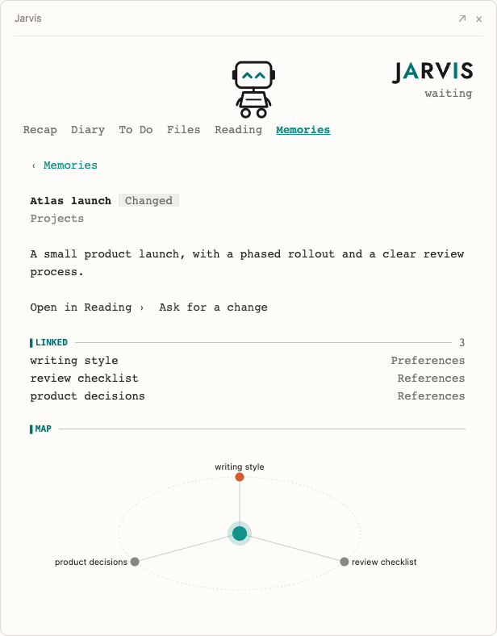

# Cockpit

The cockpit is an optional panel for Jarvis Lite in the Claude Code desktop app
on macOS. It sits beside the chat and shows the workspace at a glance, so you
can see where you left off without asking.

## What it shows

| Tab | What you find |
|---|---|
| Recap | Today, the last session (even when it was days ago), and the next step with a prompt ready to resume. While Jarvis works: what it is doing, with times. |
| Diary | Each daily note in full, day by day. |
| To Do | Your `To Do.md`: tick, add, and remove items. |
| Files | The workspace tree with its Git status; move, duplicate, or trash a file you pick. |
| Reading | A Markdown file, readable and editable. |
| Memories | Jarvis's durable memories as a list and a graph, read-only. |

The panel speaks the language of your workspace: Italian when your identity
says Italian is your language, English otherwise.

## A closer look

These browser-rendered previews use the cockpit's existing view components
and fictional workspace data. Text spacing and controls can differ slightly
in the desktop app.

### Recap: pick up where you left off

See what needs attention today, the result of the last session, and one next
step. **Resume** prepares the continuation prompt; you decide when to send it.



### To Do: keep current work within reach

Read the declared Future work source, check an item off, or add another in
its section. The panel updates the same Markdown file that Jarvis uses.



### Memories: follow the connections

Open a memory to see its description, linked notes, and their small map.
Memories are read-only here; **Ask for a change** routes an update request
through Jarvis.



## Install and remove

First run offers to install the cockpit at the end of onboarding. To install it
yourself, run this in a terminal from the workspace folder, then open the
workspace in the desktop app:

```bash
claude plugin install jarvis-cockpit --marketplace Erionis/Jarvis-Lite --scope project
```

The panel opens beside the chat at your first message of each session. If you
close it, type `/jarvis` to open it again.

`--scope project` keeps the cockpit to this workspace. To remove it, run
`claude plugin uninstall jarvis-cockpit --scope project` from the workspace
folder. The install also added the `jarvis-lite` marketplace to your Claude
Code settings; `claude plugin marketplace remove jarvis-lite` removes it when
nothing else uses it. Removing the plugin keeps its preferences and session
records; see below to clear them.

## What it writes and keeps

- It writes `To Do.md` (the declared Future work source) and the files you edit
  in Reading. From the Files tab it also moves, duplicates, or trashes a file
  you pick; trashed files go to the macOS Trash. Identity, memories, diary,
  `To Do.md`, `CLAUDE.md`, `AGENTS.md`, and the managed core in
  `99 - Jarvis/system/` are never moved or trashed, and all of them except
  `To Do.md` are read-only.
- It makes no model calls and no network requests.
- It keeps its preferences and a record of the last 30 sessions in Claude
  Code's plugin store (`~/.claude/plugins/store/`). Each record keeps:
  - the first 160 characters of the session's first prompt;
  - the paths of up to 20 files the session wrote;
  - the path, topic, and status of the last handoff it wrote, and the day of
    the last diary note it wrote;
  - the topic it resumed, when it started from the cockpit's resume prompt;
  - its times and a few counts.

  Delete its files, `~/.claude/plugins/store/jarvis-cockpit_*.json`, to clear
  them.

## The mascot

The robot at the top is the Terminal: a screen face on wheels. You can change
the mascot: ask Jarvis. A custom mascot is a set of SVG files in
`99 - Jarvis/mascot/`, one per pose; the `cockpit-mascot` skill that ships with
the plugin explains the format and the rules Jarvis follows.

## Compatibility

macOS only for now. The panel draws in the Claude Code desktop app; in a
terminal session it shows a single line. Trash in the Files tab uses the
`/usr/bin/trash` command of recent macOS versions; where it is missing, the
cockpit reports the error and moves nothing.

Maintainers can [regenerate these previews](cockpit-preview/README.md) from the
demo fixture and current plugin components.
